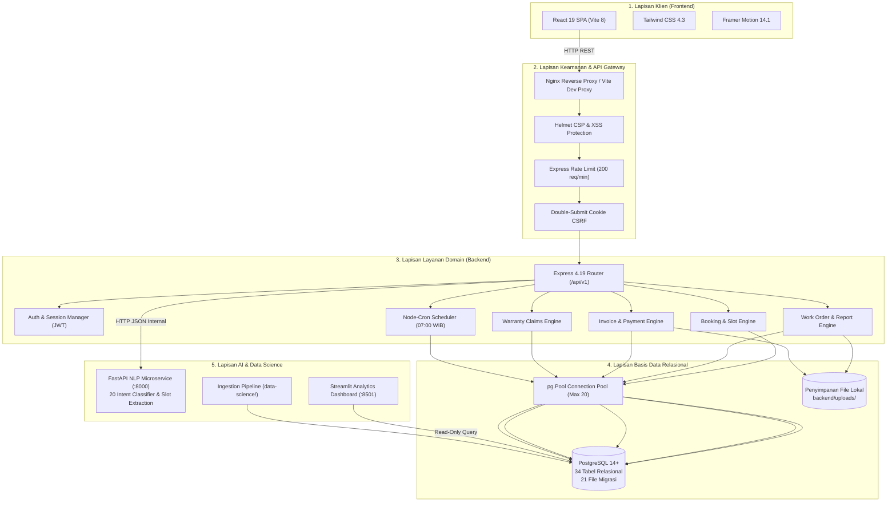

# 04. ARSITEKTUR SISTEM & TOPOLOGI KOMPONEN

**Kode Proyek:** `A26-CS054`  
**Perusahaan:** **CV. Nara Teknindotama**  

---

## 1. Pendekatan Arsitektur Multi-Tier
Sistem NARA AC dirancang menggunakan arsitektur berlapis (*layered multi-tier architecture*) dengan pemisahan tanggung jawab (*separation of concerns*) yang jelas antara presentasi antarmuka klien, logika bisnis dan orkestrasi backend, penyimpanan data terkelola, serta pemrosesan kecerdasan buatan (*AI/ML*) dan analitika data.

---

## 2. Batas Tanggung Jawab Komponen (*Component Boundaries*)

### 2.1 Frontend Client (React 19 + Vite 8)
- **Tanggung Jawab:** Menyajikan antarmuka pengguna responsif, memproses input form, melakukan validasi awal (*client-side validation*), menampilkan indikator loading (*PageLoader*), menangani galat jaringan secara anggun (*ErrorBoundary*), dan mengelola navigasi riwayat kontekstual (*useContextualBack*).
- **Isolasi Keamanan:** Klien tidak menyimpan rahasia bisnis (seperti secret JWT atau rumus perhitungan harga tersembunyi). Seluruh nilai yang ditampilkan berasal dari respons API yang telah diverifikasi otoritatif oleh server.

### 2.2 Backend Gateway & API (Node.js 18+ & Express 4.19)
- **Tanggung Jawab:** Menerima permintaan HTTP dari klien, menjalankan penyaringan keamanan (CORS, Helmet, Rate Limiter, CSRF token ganda), memvalidasi skema payload JSON melalui Joi, mengeksekusi logika transaksi perbankan dan reservasi dalam blok transaksi PostgreSQL ACID, dan menerbitkan token otentikasi JWT yang ditandatangani secara kriptografis.
- **Port Layanan:** Berjalan pada port internal **`4000`** (dengan proxy Vite dev `/api` mengarah ke `http://localhost:4000`).

### 2.3 Basis Data Relasional (PostgreSQL 14+)
- **Tanggung Jawab:** Menyimpan data terstruktur secara persisten melingkupi 34 tabel relasional. Menegakkan integritas referensial (foreign keys, check constraints, unique constraints, dan cascading rules) serta memastikan isolasi data multi-pengguna.

### 2.4 Sub-sistem AI NLP (Python FastAPI)
- **Tanggung Jawab:** Menyediakan inferensi klasifikasi teks cepat (<50 ms) terhadap 20 intent percakapan dan mengekstrak entitas seperti merk AC, kapasitas PK, kuantitas unit, dan kode reservasi. Dilengkapi pustaka mandiri `ml_compat.py` sebagai fallback murni Python.
- **Port Layanan:** Berjalan pada port internal **`8000`**.

### 2.5 Sub-sistem Data Science & Dashboard (Streamlit & Scikit-Learn)
- **Tanggung Jawab:** Melakukan pembersihan data, tokenisasi PII pada 4 dataset operasional nyata, melatih model peramalan Ridge tanpa kebocoran target (*target leakage*), serta menyajikan dashboard visual analitik operasional terpisah pada port **`8501`**.

---

## 3. Topologi Jaringan & Komunikasi Antar-Komponen
1. **Komunikasi Frontend ke Backend:** Protokol HTTP/1.1 atau HTTP/2 terenkripsi SSL/TLS (HTTPS) menggunakan format pertukaran data JSON standar RESTful.
2. **Komunikasi Backend ke Database:** Protokol TCP/IP native PostgreSQL melalui connection pool `pg.Pool` dengan manajemen koneksi efisien (maksimum 20 pool client).
3. **Komunikasi Backend ke AI Service:** Protokol HTTP internal antarservis (*service-to-service*) pada localhost port 8000 dengan batas waktu *timeout* aman (6000 ms).
4. **Komunikasi Eksternal WhatsApp:** Protokol HTTPS keluar (*outbound*) menuju gateway penyedia pesan WhatsApp, dan webhook masuk (*inbound webhook*) dengan verifikasi tanda tangan HMAC-SHA256 pada header request.
