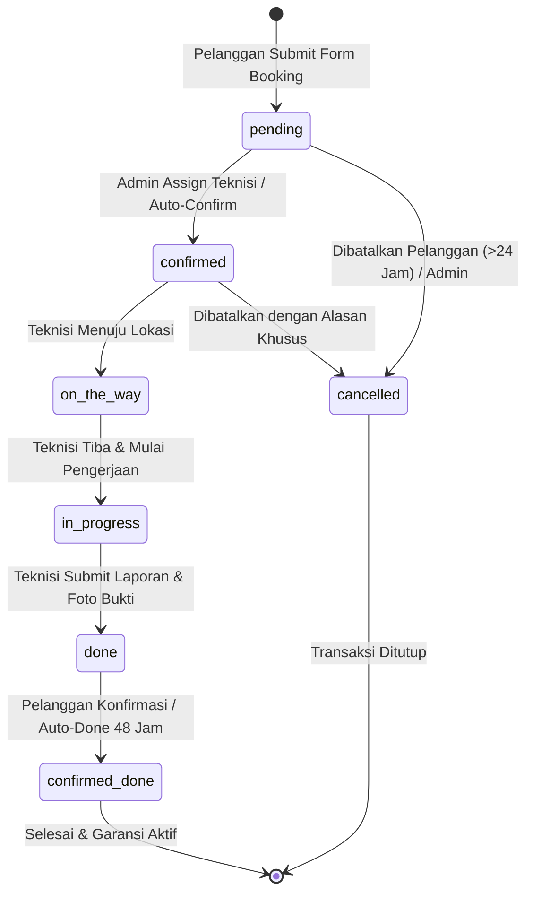
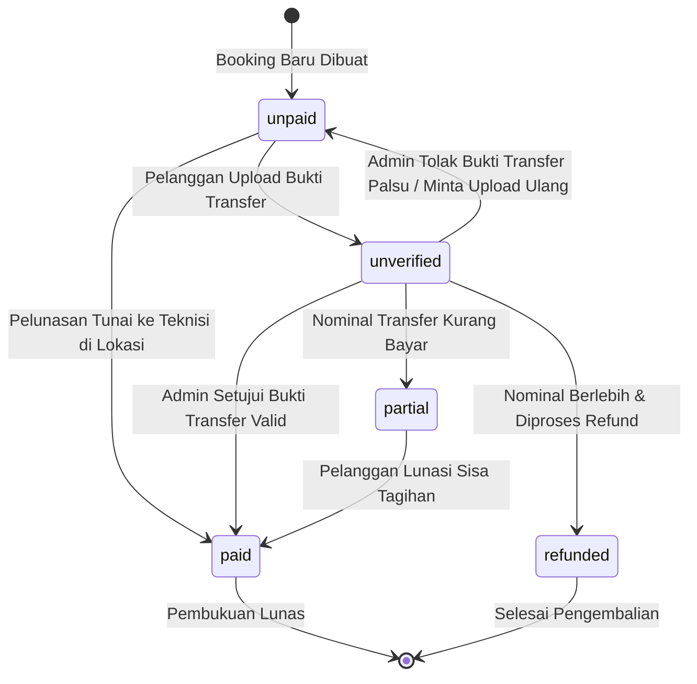
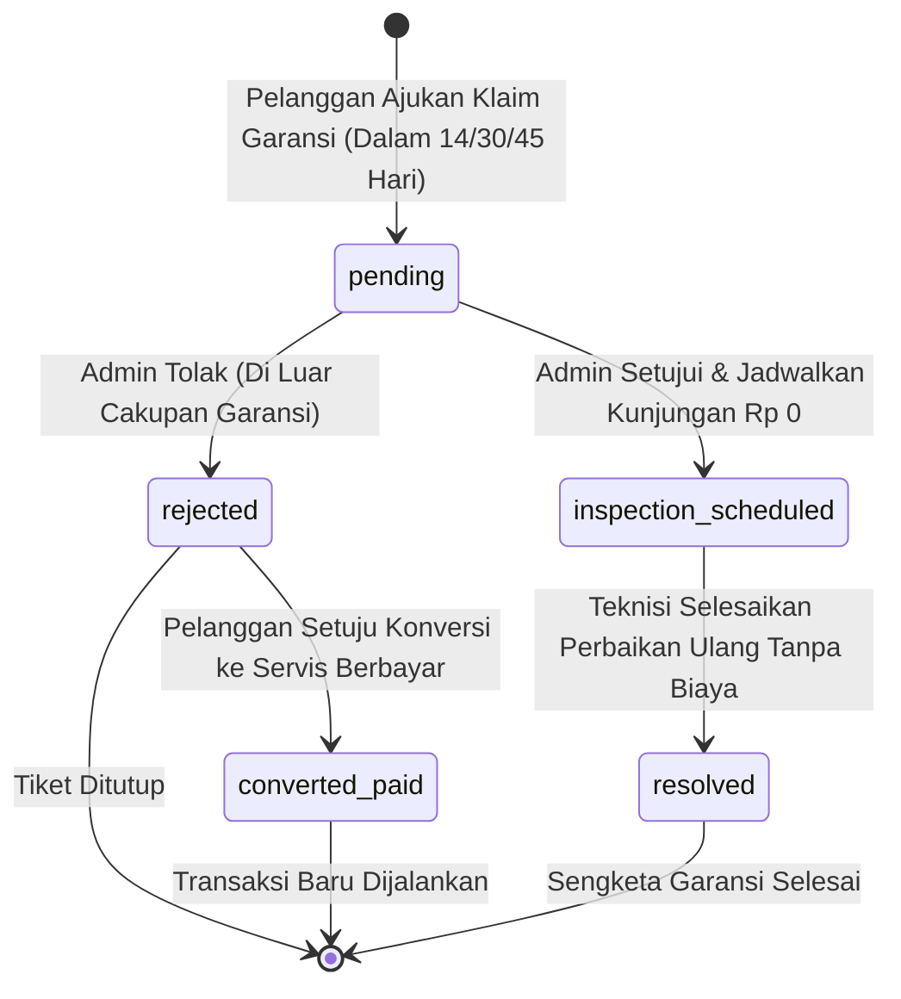

# 06. PEMODELAN ALUR BISNIS (ACTIVITY & SEQUENCE)

**Kode Proyek:** `A26-CS054`  
**Entitas Usaha:** **CV. Nara Teknindotama**  

---

## 1. Siklus Hidup & Mesin Status Transaksi (*State Machines*)

Transaksi pemesanan, pembayaran, dan garansi dalam sistem NARA AC dikendalikan oleh mesin status terstruktur (*finite state machines*) yang memastikan transisi nilai hanya dapat terjadi melalui tindakan aktor yang terotorisasi:

### 1.1 Diagram Mesin Status Pemesanan (*Booking Lifecycle*)

### 1.2 Diagram Mesin Status Pembayaran (*Payment Lifecycle*)

### 1.3 Diagram Mesin Status Klaim Garansi (*Warranty Claim Lifecycle*)

---

## 2. Alur Proses Bisnis Lengkap

### 2.1 Alur Pemesanan & Alokasi Jadwal
Alur diagram pemodelan flowchart pemesanan tersimpan pada berkas [04-alur-booking.mmd](./diagrams/04-alur-booking.mmd).

Tahapan Utama:
1. **Penetapan Durasi:** Sistem secara otomatis menghitung durasi yang dibutuhkan berdasar kuantitas unit AC (`durasi = durasi_katalog * jumlah_unit`).
2. **Uji Batas Waktu Operasional:** Jam mulai servis ditambah total durasi diuji terhadap jam operasional `08:00–19:00 WIB`. Pemesanan yang akan selesai melewati pukul 19:00 WIB ditolak seketika (`DURATION_EXCEEDS_CLOSING`).
3. **Pemeriksaan Beban Teknisi:** Kapasitas teknisi aktif (dikurangi teknisi cuti/sibuk di tabel `technician_availability`) diperiksa untuk mencegah jadwal tumpang tindih.
4. **Perhitungan Diskon Finansial Otoritatif:** Backend secara otomatis memeriksa keanggotaan pelanggan. Jika berstatus member aktif, diskon 10% dihitung khusus pada biaya jasa (`biaya_jasa * 0.9`), sedangkan komponen biaya suku cadang dibebankan 100% tanpa diskon.

### 2.2 Alur Eksekusi Pekerjaan Teknisi
Alur diagram flowchart pengerjaan lapangan teknisi tersimpan pada berkas [08-alur-pekerjaan-teknisi.mmd](./diagrams/08-alur-pekerjaan-teknisi.mmd).

Tahapan Utama:
1. **Penerimaan Tugas:** Teknisi menerima penugasan di antarmuka web mobile gawai masing-masing (`/technician/jobs`).
2. **Dokumentasi Kondisi Awal:** Teknisi wajib mengambil dan mengunggah foto kondisi fisik AC sebelum dicuci atau diperbaiki.
3. **Pemeriksaan Diagnostik:** Pengisian lembar checklist digital (evaluasi filter udara, kebersihan kisi-kisi evaporator, pengukuran tekanan freon, dan pengujian arus listrik ampere).
4. **Persetujuan Ganda Biaya Tambahan:** Jika teknisi menemukan komponen rusak (seperti kapasitor mati atau kebocoran pipa), penambahan suku cadang dan biaya jasa tambahan wajib disetujui bersama oleh pelanggan dan admin operasional (*dual approval*).
5. **Dokumentasi Kondisi Akhir:** Teknisi mengunggah foto AC sesudah diservis dan memasukkan catatan rekomendasi pemeliharaan.

### 2.3 Alur Pembayaran & Rekonsiliasi Kas
Alur diagram flowchart pembayaran tersimpan pada berkas [07-alur-pembayaran.mmd](./diagrams/07-alur-pembayaran.mmd).

Tahapan Utama:
1. **Penerbitan Estimasi Awal:** Begitu pemesanan dibuat, sistem menerbitkan faktur estimasi awal (`ESTIMASI AWAL`) dengan rincian biaya yang disepakati.
2. **Pembayaran & Verifikasi Transfer:** Jika pelanggan memilih transfer bank, bukti transfer diunggah via form aman dengan verifikasi *magic-byte* biner. Status pembayaran berada pada status `unverified` hingga admin kantor memverifikasi mutasi rekening koran bank secara manual.
3. **Penerbitan Faktur Pajak Final:** Setelah pekerjaan diselesaikan teknisi, sistem menerbitkan faktur final resmi (`INVOICE FINAL`) yang mencakup rincian suku cadang aktual dan cap digital lunas.

### 2.4 Alur Jaminan Garansi Purnajual
Alur diagram flowchart garansi tersimpan pada berkas [09-alur-garansi.mmd](./diagrams/09-alur-garansi.mmd).

Tahapan Utama:
1. **Penguncian Ulasan Kepuasan (Review Gate):** Pelanggan yang hendak mengajukan klaim garansi diwajibkan telah mengisi penilaian rating kepuasan (1-5 bintang).
2. **Validasi Rentang Waktu:** Sistem memeriksa apakah tanggal klaim masih berada dalam jendela garansi (14 hari untuk cuci standar, 30 hari untuk cuci deep clean, dan 45 hari untuk freon).
3. **Aturan Satu Klaim Aktif:** Sistem menolak pengajuan jika masih ada tiket klaim yang berstatus aktif/berjalan untuk nomor booking tersebut.
4. **Kunjungan Ulang Rp 0:** Klaim yang disetujui admin akan dibuatkan surat perintah kerja kunjungan inspeksi ulang dengan biaya tagihan Rp 0 (Gratis).

### 2.5 Alur Otomasi Pengingat WhatsApp & Penanganan Kegagalan
Alur diagram flowchart pengingat servis WhatsApp tersimpan pada berkas [10-alur-pengingat-whatsapp.mmd](./diagrams/10-alur-pengingat-whatsapp.mmd).

Tahapan Utama:
1. **Pemicu Cron Harian:** Penjadwal internal `node-cron` dieksekusi setiap hari pukul 07:00 WIB.
2. **Penyaringan Interval Unit:** Sistem mendeteksi unit AC yang tanggal servis terakhirnya telah melampaui `interval_perawatan_hari` (standar 60–90 hari).
3. **Deduplikasi 30 Hari:** Unit yang telah dikirimi pengingat dalam 30 hari kalender terakhir dilewati untuk menghindari pesan berulang.
4. **Mekanisme Percobaan Ulang (Retry):** Jika terjadi kegagalan transmisi jaringan HTTP ke gateway WhatsApp, pesan dimasukkan ke antrean percobaan ulang berkala hingga maksimal 3 kali sebelum ditandai gagal permanen.
