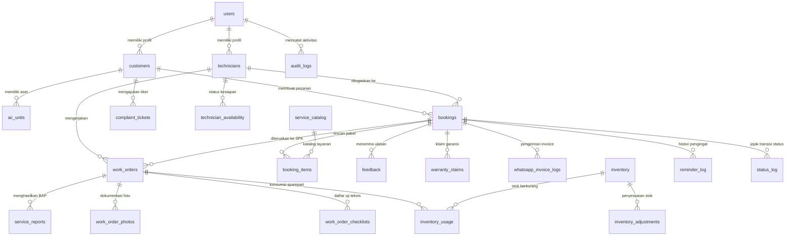
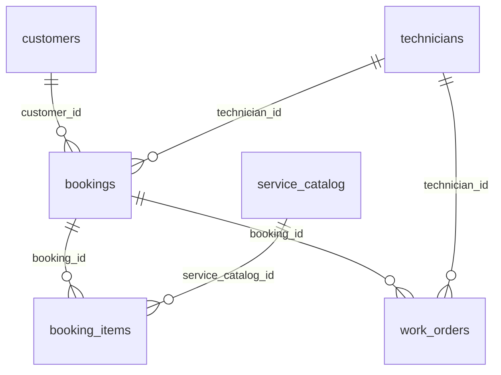
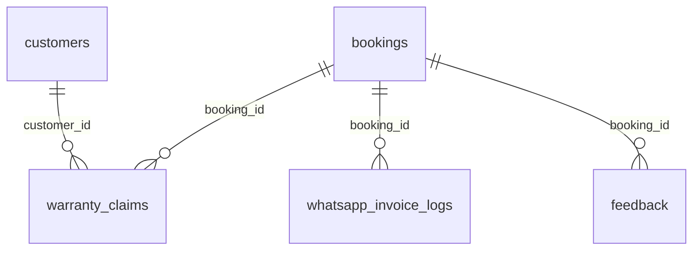
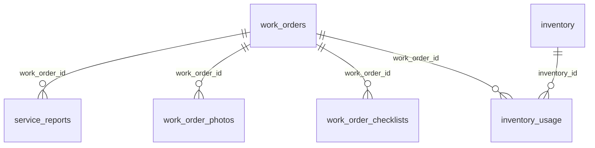

# 07 — Desain Basis Data (Database Design)

Dokumen ini mendokumentasikan arsitektur basis data relasional sistem **NARA AC — CV. Nara Teknindotama** (Kode Proyek: **A26-CS054**). Seluruh definisi skema didasarkan pada 21 file migrasi SQL aktif (`backend/migrations/001_init.sql` hingga `020_b2b_projects_and_rfm.sql`) pada engine **PostgreSQL 14+**.

---

## 1. Ringkasan Arsitektur Basis Data

- **Database Management System (DBMS):** PostgreSQL 14+
- **Nama Basis Data:** `nara_ac`
- **Schema:** `public`
- **Jumlah Tabel:** 34 Tabel Relasional
- **Jumlah Migrasi:** 21 Skrip Migrasi Terurut
- **Mekanisme Migrasi:** `backend/src/utils/migrate.js` (Menjalankan transaksi `BEGIN ... COMMIT` per file dengan tabel pelacak `migrations`)
- **Fitur Kunci:**
  - Foreign Key Constraints dengan `ON DELETE RESTRICT` pada entitas finansial dan histori servis.
  - Idempotency via Unique Constraints (`idempotency_key`, `nomor_invoice`, `serial_number`).
  - Row-Level Locking (`FOR UPDATE`) pada alokasi teknisi dan pembayaran untuk pencegahan *race conditions*.
  - Audit Trail menyeluruh pada tabel `audit_logs`, `booking_audit`, `status_log`, dan `schedule_history`.

---

## 2. Diagram Hubungan Entitas (ERD)

Diagram ERD sistem NARA AC disajikan secara modular berdasarkan domain bisnis dan diagram komprehensif.

### 2.1 ERD Komprehensif Seluruh Skema
Diagram Mermaid lengkap tersimpan pada berkas [`docs/diagrams/03-erd.mmd`](diagrams/03-erd.mmd).

### 2.2 ERD Domain Booking & Operasional Servis
Menghubungkan `customers`, `bookings`, `booking_items`, `service_catalog`, `technicians`, dan `work_orders`.

### 2.3 ERD Domain Invoice, Pembayaran & Garansi
Menghubungkan `bookings`, `customers`, `warranty_claims`, dan `whatsapp_invoice_logs`.

### 2.4 ERD Domain Pelaporan & Dokumentasi Kerja Lapangan
Menghubungkan `work_orders`, `service_reports`, `work_order_photos`, `work_order_checklists`, dan `inventory_usage`.

---

## 3. Kamus Data (Data Dictionary)

Berikut adalah daftar lengkap 34 tabel basis data `nara_ac` beserta atribut kunci dan deskripsi fungsinya:

### 3.1 Entitas Pengguna & Otorisasi

#### 1. `users`
Menyimpan akun login pengguna untuk semua peran sistem.
- `id` (SERIAL, PK) — ID pengguna.
- `nama` (VARCHAR(100), NOT NULL) — Nama lengkap.
- `email` (VARCHAR(150), UNIQUE, NOT NULL) — Alamat email autentikasi.
- `password_hash` (VARCHAR(255), NOT NULL) — Password terenkripsi bcrypt (10 rounds).
- `role` (VARCHAR(20), NOT NULL, DEFAULT 'pelanggan') — Peran: `'admin'`, `'teknisi'`, `'pelanggan'`.
- `kontak` (VARCHAR(20), NULL) — Nomor telepon atau WhatsApp.
- `is_active` (BOOLEAN, DEFAULT true) — Status aktif akun.
- `created_at`, `updated_at` (TIMESTAMP WITH TIME ZONE, DEFAULT NOW()).

#### 2. `customers`
Profil detail pelanggan perumahan (B2C) maupun perwakilan perusahaan (B2B).
- `id` (SERIAL, PK) — ID pelanggan.
- `user_id` (INT, FK -> `users.id`, UNIQUE, NULL) — Relasi ke akun login (jika terdaftar mandiri).
- `nama` (VARCHAR(100), NOT NULL) — Nama pelanggan.
- `telepon` (VARCHAR(20), NOT NULL) — Nomor telepon aktif.
- `alamat` (TEXT, NOT NULL) — Alamat domisili/lokasi unit AC.
- `latitude`, `longitude` (DECIMAL(10,8), NULL) — Koordinat geospasial untuk rute teknisi.
- `tipe` (VARCHAR(20), DEFAULT 'residential') — Tipe pelanggan: `'residential'` atau `'corporate'`.
- `created_at`, `updated_at` (TIMESTAMP WITH TIME ZONE, DEFAULT NOW()).

#### 3. `technicians`
Data operasional teknisi lapangan NARA AC.
- `id` (SERIAL, PK) — ID teknisi.
- `user_id` (INT, FK -> `users.id`, UNIQUE, NOT NULL) — Akun login teknisi.
- `nama` (VARCHAR(100), NOT NULL) — Nama teknisi.
- `telepon` (VARCHAR(20), NOT NULL) — Nomor kontak teknisi.
- `keahlian` (VARCHAR(100), NULL) — Spesialisasi (misal: Split, Cassette, Inverter, Ducting).
- `rating` (DECIMAL(3,2), DEFAULT 5.00) — Rata-rata rating kumulatif dari ulasan pelanggan.
- `is_available` (BOOLEAN, DEFAULT true) — Status kesiapan menerima penugasan baru.
- `created_at`, `updated_at` (TIMESTAMP WITH TIME ZONE, DEFAULT NOW()).

#### 4. `technician_availability`
Pengaturan kalender jadwal kerja dan ketidakhadiran teknisi.
- `id` (SERIAL, PK).
- `technician_id` (INT, FK -> `technicians.id`, NOT NULL).
- `tanggal` (DATE, NOT NULL).
- `status` (VARCHAR(20), DEFAULT 'Tersedia') — Status: `'Tersedia'`, `'Libur'`, `'Sakit'`, `'Izin'`.
- `keterangan` (TEXT, NULL).

---

### 3.2 Entitas Aset & Katalog Layanan

#### 5. `ac_units`
Aset unit pendingin udara yang dimiliki pelanggan.
- `id` (SERIAL, PK).
- `customer_id` (INT, FK -> `customers.id`, NOT NULL).
- `brand` (VARCHAR(50), NOT NULL) — Merek AC (misal: Daikin, Panasonic, Sharp).
- `model` (VARCHAR(50), NULL) — Seri model.
- `tipe_ac` (VARCHAR(50), DEFAULT 'Split') — Tipe AC (`'Split'`, `'Cassette'`, `'Standing'`, `'Inverter'`).
- `pk` (VARCHAR(10), NOT NULL) — Daya pendinginan (`'0.5 PK'`, `'1 PK'`, `'1.5 PK'`, `'2 PK'`).
- `refrigerant_type` (VARCHAR(20), DEFAULT 'R32') — Jenis refrigeran (`'R32'`, `'R410A'`, `'R22'`).
- `serial_number` (VARCHAR(100), UNIQUE, NULL) — Nomor seri pabrikan unik.
- `lokasi_ruangan` (VARCHAR(100), NULL) — Label ruangan (misal: "Kamar Utama", "Ruang Server").
- `tahun_pemasangan` (INT, NULL).
- `kondisi_terakhir` (VARCHAR(50), DEFAULT 'Normal').

#### 6. `service_catalog`
Daftar baku jenis layanan dan tarif standar jasa.
- `id` (SERIAL, PK).
- `kode_layanan` (VARCHAR(20), UNIQUE, NOT NULL) — Kode paket (misal: `PK-CUCI-REG`).
- `nama_layanan` (VARCHAR(100), NOT NULL).
- `kategori` (VARCHAR(50), NOT NULL) — Kategori (`'Cuci AC'`, `'Perbaikan'`, `'Bongkar Pasang'`, `'Isi Freon'`).
- `deskripsi` (TEXT, NULL).
- `harga_dasar` (DECIMAL(12,2), NOT NULL) — Tarif dasar.
- `estimasi_durasi_menit` (INT, DEFAULT 60).
- `is_active` (BOOLEAN, DEFAULT true).

---

### 3.3 Entitas Transaksi Booking & Perintah Kerja (Work Order)

#### 7. `bookings`
Tabel transaksi utama pemesanan layanan servis AC.
- `id` (SERIAL, PK).
- `customer_id` (INT, FK -> `customers.id`, NOT NULL).
- `technician_id` (INT, FK -> `technicians.id`, NULL) — Teknisi yang ditugaskan.
- `ac_unit_id` (INT, FK -> `ac_units.id`, NULL).
- `tanggal_booking` (DATE, NOT NULL).
- `jam_booking` (TIME, NOT NULL).
- `tipe_layanan` (VARCHAR(100), NOT NULL).
- `keluhan` (TEXT, NULL).
- `status` (VARCHAR(30), DEFAULT 'Menunggu Konfirmasi') — State: `'Menunggu Konfirmasi'`, `'Dikonfirmasi'`, `'Teknisi Ditugaskan'`, `'Dalam Perjalanan'`, `'Sedang Dikerjakan'`, `'Menunggu Pembayaran'`, `'Menunggu Konfirmasi Pembayaran'`, `'Selesai'`, `'Dibatalkan'`.
- `jumlah_unit` (INT, DEFAULT 1).
- `total_biaya` (DECIMAL(12,2), DEFAULT 0.00).
- `status_pembayaran` (VARCHAR(30), DEFAULT 'Belum Dibayar') — `'Belum Dibayar'`, `'Menunggu Verifikasi'`, `'Lunas'`, `'Kedaluwarsa'`, `'Dibatalkan'`.
- `nomor_invoice` (VARCHAR(50), UNIQUE, NULL) — Nomor faktur baku (contoh: `INV/20261017/0001`).
- `metode_pembayaran` (VARCHAR(50), NULL) — `'Transfer Bank BCA'`, `'Transfer Bank Mandiri'`, `'Tunai'`.
- `bukti_transfer_url` (VARCHAR(255), NULL) — Jalur berkas gambar bukti pembayaran.
- `idempotency_key` (VARCHAR(100), UNIQUE, NULL) — Token pencegah duplikasi request order.
- `garansi_selesai` (DATE, NULL) — Tanggal kedaluwarsa masa garansi.
- `created_at`, `updated_at` (TIMESTAMP WITH TIME ZONE, DEFAULT NOW()).

#### 8. `booking_items`
Daftar rincian paket layanan dalam satu booking pesanan.
- `id` (SERIAL, PK).
- `booking_id` (INT, FK -> `bookings.id` ON DELETE CASCADE, NOT NULL).
- `service_catalog_id` (INT, FK -> `service_catalog.id`, NULL).
- `nama_item` (VARCHAR(100), NOT NULL).
- `qty` (INT, DEFAULT 1).
- `harga_satuan` (DECIMAL(12,2), NOT NULL).
- `subtotal` (DECIMAL(12,2), NOT NULL).

#### 9. `work_orders`
Surat Perintah Kerja (SPK) teknisi yang diterbitkan dari booking.
- `id` (SERIAL, PK).
- `nomor_spk` (VARCHAR(50), UNIQUE, NOT NULL).
- `booking_id` (INT, FK -> `bookings.id`, NOT NULL).
- `technician_id` (INT, FK -> `technicians.id`, NOT NULL).
- `status` (VARCHAR(30), DEFAULT 'Ditugaskan') — `'Ditugaskan'`, `'Dalam Perjalanan'`, `'Tiba di Lokasi'`, `'Dikerjakan'`, `'Selesai'`, `'Pending'`.
- `catatan_admin` (TEXT, NULL).
- `waktu_mulai`, `waktu_selesai` (TIMESTAMP WITH TIME ZONE, NULL).

#### 10. `service_reports`
Berita Acara Pekerjaan (BAP) yang diisi teknisi di lapangan setelah pekerjaan selesai.
- `id` (SERIAL, PK).
- `work_order_id` (INT, FK -> `work_orders.id`, NOT NULL).
- `booking_id` (INT, FK -> `bookings.id`, NOT NULL).
- `catatan_pekerjaan` (TEXT, NOT NULL).
- `kondisi_sebelum` (TEXT, NULL).
- `kondisi_sesudah` (TEXT, NULL).
- `rekomendasi_lanjutan` (TEXT, NULL).
- `tekanan_freon_sebelum`, `tekanan_freon_sesudah` (VARCHAR(20), NULL).
- `arus_listrik_ampere` (VARCHAR(20), NULL).
- `suhu_keluar_celsius` (VARCHAR(20), NULL).
- `tanda_tangan_pelanggan_url` (VARCHAR(255), NULL).
- `created_at` (TIMESTAMP WITH TIME ZONE, DEFAULT NOW()).

#### 11. `work_order_photos`
Galeri dokumentasi foto sebelum (*before*) dan sesudah (*after*) pekerjaan teknis.
- `id` (SERIAL, PK).
- `work_order_id` (INT, FK -> `work_orders.id`, NOT NULL).
- `tipe_foto` (VARCHAR(20), NOT NULL) — `'before'`, `'after'`, `'part_replacement'`.
- `file_url` (VARCHAR(255), NOT NULL).
- `keterangan` (TEXT, NULL).
- `created_at` (TIMESTAMP WITH TIME ZONE, DEFAULT NOW()).

#### 12. `work_order_checklists`
Daftar checklist keselamatan dan tahapan standar prosedur operasional (SOP).
- `id` (SERIAL, PK).
- `work_order_id` (INT, FK -> `work_orders.id`, NOT NULL).
- `item_pemeriksaan` (VARCHAR(150), NOT NULL).
- `is_checked` (BOOLEAN, DEFAULT false).
- `keterangan` (TEXT, NULL).

---

### 3.4 Entitas Pasca-Servis, Garansi & Ulasan

#### 13. `feedback`
Ulasan bintang dan testimoni kepuasan pelanggan atas hasil servis.
- `id` (SERIAL, PK).
- `booking_id` (INT, FK -> `bookings.id`, UNIQUE, NOT NULL).
- `customer_id` (INT, FK -> `customers.id`, NOT NULL).
- `rating` (INT, CHECK (rating >= 1 AND rating <= 5), NOT NULL).
- `komentar` (TEXT, NULL).
- `is_published` (BOOLEAN, DEFAULT true).
- `created_at` (TIMESTAMP WITH TIME ZONE, DEFAULT NOW()).

#### 14. `warranty_claims`
Pengajuan klaim garansi jika unit mengalami kendala dalam masa garansi 30 hari.
- `id` (SERIAL, PK).
- `nomor_klaim` (VARCHAR(50), UNIQUE, NOT NULL).
- `booking_id` (INT, FK -> `bookings.id`, NOT NULL).
- `customer_id` (INT, FK -> `customers.id`, NOT NULL).
- `deskripsi_kerusakan` (TEXT, NOT NULL).
- `foto_bukti_url` (VARCHAR(255), NULL).
- `status_klaim` (VARCHAR(30), DEFAULT 'Menunggu Verifikasi') — `'Menunggu Verifikasi'`, `'Disetujui'`, `'Jadwal Kunjungan Ulang'`, `'Ditolak'`, `'Selesai'`.
- `catatan_admin` (TEXT, NULL).
- `jadwal_kunjungan_ulang` (DATE, NULL).
- `created_at`, `updated_at` (TIMESTAMP WITH TIME ZONE, DEFAULT NOW()).

#### 15. `complaint_tickets`
Tiket keluhan pelanggan non-garansi atau administratif.
- `id` (SERIAL, PK).
- `customer_id` (INT, FK -> `customers.id`, NOT NULL).
- `subjek` (VARCHAR(150), NOT NULL).
- `pesan` (TEXT, NOT NULL).
- `status` (VARCHAR(20), DEFAULT 'Open') — `'Open'`, `'In Progress'`, `'Resolved'`, `'Closed'`.
- `created_at`, `updated_at` (TIMESTAMP WITH TIME ZONE, DEFAULT NOW()).

---

### 3.5 Entitas Inventaris & Suku Cadang

#### 16. `inventory`
Master data suku cadang, material, dan refrigeran di gudang teknis.
- `id` (SERIAL, PK).
- `kode_barang` (VARCHAR(50), UNIQUE, NOT NULL).
- `nama_barang` (VARCHAR(100), NOT NULL).
- `kategori` (VARCHAR(50), NOT NULL) — `'Sparepart'`, `'Refrigerant'`, `'Pipa & Kabel'`, `'Alat'`.
- `stok` (INT, NOT NULL, DEFAULT 0).
- `stok_minimum` (INT, NOT NULL, DEFAULT 5).
- `satuan` (VARCHAR(20), NOT NULL) — `'Pcs'`, `'Kg'`, `'Meter'`, `'Roll'`.
- `harga_beli` (DECIMAL(12,2), NOT NULL).
- `harga_jual` (DECIMAL(12,2), NOT NULL).

#### 17. `inventory_usage`
Pencatatan pemakaian suku cadang dalam SPK/pekerjaan teknisi.
- `id` (SERIAL, PK).
- `work_order_id` (INT, FK -> `work_orders.id`, NOT NULL).
- `inventory_id` (INT, FK -> `inventory.id`, NOT NULL).
- `jumlah` (INT, NOT NULL).
- `harga_satuan` (DECIMAL(12,2), NOT NULL).
- `created_at` (TIMESTAMP WITH TIME ZONE, DEFAULT NOW()).

#### 18. `inventory_adjustments`
Log penyesuaian stok (stock opname / barang rusak).
- `id` (SERIAL, PK).
- `inventory_id` (INT, FK -> `inventory.id`, NOT NULL).
- `jumlah_perubahan` (INT, NOT NULL) — Positif (penambahan) atau negatif (pengurangan).
- `alasan` (TEXT, NOT NULL).
- `user_id` (INT, FK -> `users.id`, NOT NULL).
- `created_at` (TIMESTAMP WITH TIME ZONE, DEFAULT NOW()).

---

### 3.6 Entitas Proyek B2B & Analitika RFM

#### 19. `b2b_projects`
Proyek pemeliharaan korporat/instansi dengan cakupan multi-unit.
- `id` (SERIAL, PK).
- `customer_id` (INT, FK -> `customers.id`, NOT NULL).
- `nama_proyek` (VARCHAR(150), NOT NULL).
- `lokasi_gedung` (VARCHAR(200), NOT NULL).
- `jumlah_unit_total` (INT, NOT NULL).
- `nilai_kontrak` (DECIMAL(15,2), NOT NULL).
- `tanggal_mulai`, `tanggal_selesai` (DATE, NOT NULL).
- `status_proyek` (VARCHAR(30), DEFAULT 'Aktif') — `'Aktif'`, `'Selesai'`, `'Tertunda'`.
- `created_at`, `updated_at` (TIMESTAMP WITH TIME ZONE, DEFAULT NOW()).

#### 20. `prediction_output`
Tabel hasil inferensi model prediktif harian (misal: peramalan order 14 hari ke depan).
- `id` (SERIAL, PK).
- `tanggal_prediksi` (DATE, NOT NULL).
- `estimasi_demand_order` (INT, NOT NULL).
- `estimasi_beban_teknisi` (INT, NOT NULL).
- `confidence_score` (DECIMAL(5,4), NULL).
- `generated_at` (TIMESTAMP WITH TIME ZONE, DEFAULT NOW()).

---

### 3.7 Entitas Komunikasi, AI & WhatsApp Gateway

#### 21. `whatsapp_conversations`
Sesi percakapan antara pelanggan dengan sistem AI/Admin via WhatsApp.
- `id` (SERIAL, PK).
- `customer_id` (INT, FK -> `customers.id`, NULL).
- `nomor_wa` (VARCHAR(30), NOT NULL).
- `pesan_masuk` (TEXT, NOT NULL).
- `pesan_keluar` (TEXT, NULL).
- `intent_terdeteksi` (VARCHAR(50), NULL).
- `confidence` (DECIMAL(5,4), NULL).
- `is_escalated_to_admin` (BOOLEAN, DEFAULT false).
- `created_at` (TIMESTAMP WITH TIME ZONE, DEFAULT NOW()).

#### 22. `whatsapp_otps`
Penyimpanan kode One-Time Password (OTP) login instan via WhatsApp.
- `id` (SERIAL, PK).
- `nomor_wa` (VARCHAR(30), NOT NULL).
- `otp_code` (VARCHAR(10), NOT NULL).
- `expired_at` (TIMESTAMP WITH TIME ZONE, NOT NULL).
- `is_verified` (BOOLEAN, DEFAULT false).
- `created_at` (TIMESTAMP WITH TIME ZONE, DEFAULT NOW()).

#### 23. `whatsapp_invoice_logs`
Log pengiriman link faktur dan invoice PDF via WhatsApp message gateway.
- `id` (SERIAL, PK).
- `booking_id` (INT, FK -> `bookings.id`, NOT NULL).
- `nomor_wa` (VARCHAR(30), NOT NULL).
- `status_pengiriman` (VARCHAR(30), DEFAULT 'Terkirim') — `'Pending'`, `'Terkirim'`, `'Gagal'`, `'Dibaca'`.
- `retry_count` (INT, DEFAULT 0).
- `response_payload` (TEXT, NULL).
- `created_at` (TIMESTAMP WITH TIME ZONE, DEFAULT NOW()).

#### 24. `whatsapp_webhook_events`
Tabel penampung payload webhook mentah dari Fonnte/Wwebjs untuk audit dan replay.
- `id` (SERIAL, PK).
- `event_type` (VARCHAR(50), NOT NULL).
- `payload` (JSONB, NOT NULL).
- `processed` (BOOLEAN, DEFAULT false).
- `created_at` (TIMESTAMP WITH TIME ZONE, DEFAULT NOW()).

#### 25. `inference_log`
Log audit latensi dan pemanggilan model NLP FastAPI.
- `id` (SERIAL, PK).
- `model_name` (VARCHAR(100), NOT NULL).
- `input_text` (TEXT, NOT NULL).
- `predicted_intent` (VARCHAR(50), NOT NULL).
- `latency_ms` (INT, NOT NULL).
- `created_at` (TIMESTAMP WITH TIME ZONE, DEFAULT NOW()).

---

### 3.8 Entitas Notifikasi, Riwayat & Audit Trail

#### 26. `notifications`
Pemberitahuan in-app bagi pengguna aplikasi web.
- `id` (SERIAL, PK).
- `user_id` (INT, FK -> `users.id`, NOT NULL).
- `judul` (VARCHAR(150), NOT NULL).
- `pesan` (TEXT, NOT NULL).
- `is_read` (BOOLEAN, DEFAULT false).
- `link_url` (VARCHAR(255), NULL).
- `created_at` (TIMESTAMP WITH TIME ZONE, DEFAULT NOW()).

#### 27. `reminder_log`
Jejak audit pengingat servis otomatis (siklus 90 hari / 3 bulan).
- `id` (SERIAL, PK).
- `booking_id` (INT, FK -> `bookings.id`, NOT NULL).
- `customer_id` (INT, FK -> `customers.id`, NOT NULL).
- `ac_unit_id` (INT, FK -> `ac_units.id`, NULL).
- `tanggal_jadwal_kirim` (DATE, NOT NULL).
- `status_pengiriman` (VARCHAR(20), DEFAULT 'Terkirim').
- `sent_at` (TIMESTAMP WITH TIME ZONE, NULL).

#### 28. `status_log`
Pencatatan riwayat transisi status booking untuk analisis waktu tunggu (lead time).
- `id` (SERIAL, PK).
- `booking_id` (INT, FK -> `bookings.id`, NOT NULL).
- `status_lama` (VARCHAR(30), NULL).
- `status_baru` (VARCHAR(30), NOT NULL).
- `diubah_oleh_user_id` (INT, FK -> `users.id`, NULL).
- `alasan` (TEXT, NULL).
- `created_at` (TIMESTAMP WITH TIME ZONE, DEFAULT NOW()).

#### 29. `schedule_history`
Riwayat perubahan jadwal kunjungan atau penugasan ulang teknisi.
- `id` (SERIAL, PK).
- `booking_id` (INT, FK -> `bookings.id`, NOT NULL).
- `tanggal_lama` (DATE, NULL).
- `jam_lama` (TIME, NULL).
- `teknisi_lama_id` (INT, FK -> `technicians.id`, NULL).
- `tanggal_baru` (DATE, NOT NULL).
- `jam_baru` (TIME, NOT NULL).
- `teknisi_baru_id` (INT, FK -> `technicians.id`, NULL).
- `alasan_perubahan` (TEXT, NOT NULL).
- `created_at` (TIMESTAMP WITH TIME ZONE, DEFAULT NOW()).

#### 30. `audit_logs`
Pencatatan aktivitas sensitif pengguna untuk audit keamanan sistem.
- `id` (SERIAL, PK).
- `user_id` (INT, FK -> `users.id`, NULL).
- `aksi` (VARCHAR(100), NOT NULL) — Misal: `'LOGIN_SUCCESS'`, `'UPDATE_PAYMENT'`, `'OVERRIDE_PRICE'`.
- `tabel_terdampak` (VARCHAR(50), NULL).
- `record_id` (INT, NULL).
- `ip_address` (VARCHAR(45), NULL).
- `user_agent` (TEXT, NULL).
- `payload_perubahan` (JSONB, NULL).
- `created_at` (TIMESTAMP WITH TIME ZONE, DEFAULT NOW()).

#### 31. `booking_audit`
Log histori modifikasi rincian pesanan booking.
- `id` (SERIAL, PK).
- `booking_id` (INT, FK -> `bookings.id`, NOT NULL).
- `changed_by` (INT, FK -> `users.id`, NULL).
- `action` (VARCHAR(50), NOT NULL).
- `details` (JSONB, NULL).
- `created_at` (TIMESTAMP WITH TIME ZONE, DEFAULT NOW()).

#### 32. `password_reset_tokens`
Token keamanan satu kali pakai untuk reset password pengguna.
- `id` (SERIAL, PK).
- `user_id` (INT, FK -> `users.id`, NOT NULL).
- `token_hash` (VARCHAR(255), NOT NULL).
- `expired_at` (TIMESTAMP WITH TIME ZONE, NOT NULL).
- `is_used` (BOOLEAN, DEFAULT false).
- `created_at` (TIMESTAMP WITH TIME ZONE, DEFAULT NOW()).

#### 33. `settings`
Tabel penyimpanan konfigurasi global aplikasi (Key-Value).
- `id` (SERIAL, PK).
- `setting_key` (VARCHAR(100), UNIQUE, NOT NULL).
- `setting_value` (TEXT, NOT NULL).
- `deskripsi` (TEXT, NULL).
- `updated_at` (TIMESTAMP WITH TIME ZONE, DEFAULT NOW()).

#### 34. `migrations`
Tabel internal sistem untuk melacak berkas migrasi database yang telah dieksekusi.
- `id` (SERIAL, PK).
- `migration_file` (VARCHAR(255), UNIQUE, NOT NULL).
- `executed_at` (TIMESTAMP WITH TIME ZONE, DEFAULT NOW()).

---

## 4. Analisis Kualitas & Integritas Basis Data

Berdasarkan audit teknis terhadap struktur SQL dan interaksi kode backend:

1. **Integritas Referensial (Referential Integrity):**
   - Seluruh relasi antar entitas utama dilindungi oleh `FOREIGN KEY` eksplisit.
   - Entitas finansial (`bookings`, `service_reports`, `inventory_usage`) dikonfigurasi dengan `ON DELETE RESTRICT` untuk mencegah terhapusnya jejak keuangan bila akun pengguna atau teknisi dinonaktifkan.
2. **Pencegahan Kondisi Balapan (Race Condition Protection):**
   - Operasi penugasan teknisi dan verifikasi pembayaran menggunakan `SELECT ... FOR UPDATE` dalam blok transaksi SQL (`BEGIN ... COMMIT`). Hal ini memastikan dua pelanggan atau admin tidak dapat memesan atau mengklaim slot teknisi yang sama secara bersamaan.
3. **Idempotensi Transaksi (Idempotency):**
   - Kolom `idempotency_key` pada tabel `bookings` dan `nomor_invoice` dengan indeks `UNIQUE` mencegah terbitnya invoice atau order ganda akibat gangguan koneksi jaringan (double-submit).
4. **Strategi Pengindeksan (Indexing):**
   - Indeks dibuat pada foreign keys utama: `idx_bookings_customer_id`, `idx_bookings_technician_id`, `idx_bookings_status`, `idx_bookings_tanggal`.
   - Indeks unik komposit diterapkan pada `technician_availability(technician_id, tanggal)` untuk mencegah jadwal ganda teknisi pada tanggal yang sama.
5. **Pemisahan Data Sensitif:**
   - Password di-hash menggunakan `bcrypt` dengan garam (salt) 10 putaran pada tabel `users`.
   - Tidak ada kredensial bank atau nomor kartu kredit yang disimpan dalam database (hanya file path bukti transfer terverifikasi).
