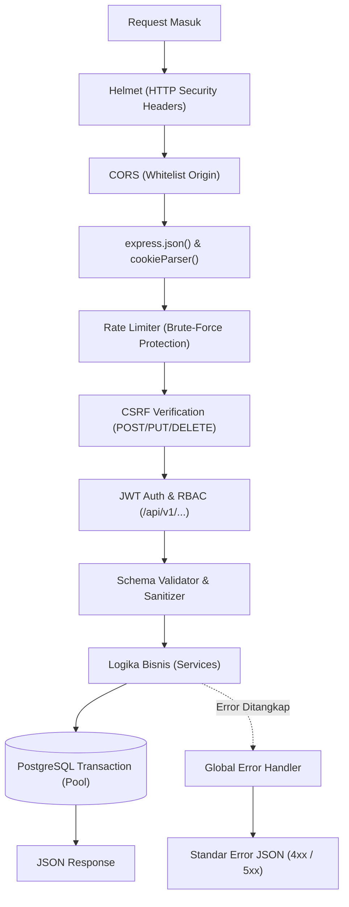

# 10 — Dokumentasi Backend

Dokumen ini mendokumentasikan arsitektur backend, lapisan middleware, transaksi basis data, penanganan berkas unggahan, dan strategi error handling pada sistem **NARA AC — CV. Nara Teknindotama** (Kode Proyek: **A26-CS054**).

---

## 1. Arsitektur & Struktur Layanan Backend

Backend NARA AC diimplementasikan dengan tumpukan teknologi modern:
- **Runtime:** Node.js 18+ (LTS)
- **Framework HTTP:** Express 4.19.2
- **Driver Database:** `pg` (Node Postgres) dengan arsitektur Connection Pooling (`backend/src/db/pool.js`)
- **Pola Desain:** *Layered Architecture* (Router -> Middleware -> Service -> Database)
- **Port Layanan:** `4000` (atau berdasarkan variabel lingkungan `PORT`)

```text
backend/src/
├── server.js                   # Inisialisasi port listener & graceful shutdown
├── app.js                      # Assembly middleware, mounting router, OpenAPI docs
├── config.js                   # Validasi variabel lingkungan terpusat
├── errors.js                   # Kelas error kustom (AppError, ValidationError, etc.)
├── db/
│   ├── pool.js                 # Konfigurasi koneksi PostgreSQL pg.Pool
│   ├── migrate.js              # Runner migrasi SQL terurut
│   └── seedFromDataScience.js  # Seeder dataset operasional nyata
├── middleware/
│   ├── auth.js                 # Verifikasi JWT & Otorisasi Berbasis Peran (RBAC)
│   ├── csrf.js                 # Validasi ganda token CSRF (Double-Submit Cookie)
│   ├── validate.js             # Validasi skema request body & sanitasi input
│   └── errorHandler.js         # Handler tangkapan error global & logging
├── routes/                     # Definisi endpoint RESTful terpisah per modul
├── services/                   # Lapisan logika bisnis murni
│   ├── bookingService.js       # Alokasi jadwal, invoice otomatis, state machine order
│   ├── paymentService.js       # Verifikasi transfer, update status Lunas, kunci mutasi
│   ├── workflowService.js      # Transisi SPK teknisi, BAP, approval harga
│   ├── warrantyService.js      # Validasi klaim 30 hari & penugasan teknisi garansi
│   ├── reminderService.js      # Siklus pengingat servis 90 hari
│   ├── aiClient.js             # Klien HTTP penghubung ke microservice FastAPI AI
│   └── analyticsService.js     # Agregasi data analitik & segmentasi RFM
└── utils/
    ├── logger.js               # Winston logger terstruktur
    ├── upload.js               # Multer wrapper dengan inspeksi binary magic-byte
    └── time.js                 # Utilitas zona waktu Asia/Jakarta (WIB)
```

---

## 2. Rantai Eksekusi Middleware (Middleware Pipeline)

Setiap permintaan HTTP yang masuk diproses melalui tahapan proteksi berlapis:



1. **Helmet & CORS:**
   - Menyuntikkan header keamanan HTTP (`Content-Security-Policy`, `X-Content-Type-Options: nosniff`, `X-Frame-Options: DENY`).
   - CORS dikonfigurasi ketat membatasi origin dari URL frontend yang diizinkan (`CLIENT_URL` / `http://localhost:5173`).
2. **Double-Submit CSRF Protection (`middleware/csrf.js`):**
   - Menerbitkan token acak berkriptografi tinggi ke dalam cookie `csrf_token`.
   - Frontend wajib menyertakan token yang sama pada header `x-csrf-token` untuk seluruh mutasi data (`POST`, `PUT`, `DELETE`).
3. **Autentikasi & RBAC (`middleware/auth.js`):**
   - Mendekripsi payload JWT (`id`, `role`, `email`).
   - Melakukan pengecekan kepemilikan data (IDOR Prevention): Pelanggan hanya diizinkan mengakses booking dan unit AC miliknya sendiri, Teknisi hanya dapat mengakses SPK yang ditugaskan kepadanya, dan Admin memiliki wewenang penuh.

---

## 3. Manajemen Transaksi & Concurrency Control

Operasi finansial dan operasional kritis dijalankan di dalam blok transaksi PostgreSQL dengan isolasi ketat:

```javascript
// Pola Baku Transaksi Backend NARA AC
const client = await pool.connect();
try {
  await client.query('BEGIN');
  
  // 1. Kunci baris data dengan FOR UPDATE untuk mencegah race condition
  const bookingCheck = await client.query(
    'SELECT status, technician_id FROM bookings WHERE id = $1 FOR UPDATE',
    [bookingId]
  );
  
  // 2. Eksekusi mutasi bisnis
  await client.query('UPDATE bookings SET status = $1 WHERE id = $2', [newStatus, bookingId]);
  
  // 3. Catat jejak audit status_log
  await client.query(
    'INSERT INTO status_log (booking_id, status_lama, status_baru, diubah_oleh_user_id) VALUES ($1, $2, $3, $4)',
    [bookingId, bookingCheck.rows[0].status, newStatus, userId]
  );
  
  await client.query('COMMIT');
} catch (error) {
  await client.query('ROLLBACK');
  throw error;
} finally {
  client.release();
}
```

- **Pencegahan Overbooking:** Pemeriksaan ketersediaan teknisi mengunci baris `technician_availability` sehingga dua permintaan booking di detik yang sama tidak akan menugaskan teknisi yang sama di jam yang sama.
- **Pencegahan Pembayaran Ganda:** Mutasi verifikasi pembayaran mengunci baris `bookings` dengan `nomor_invoice`, memastikan status `Lunas` hanya diproses satu kali.

---

## 4. Pipeline Unggah Berkas & Validasi Magic-Byte (`utils/upload.js`)

Untuk mencegah serangan *Unrestricted File Upload* (misal: pengunggahan skrip PHP/Node yang disamarkan sebagai gambar `.jpg`), NARA AC menerapkan validasi ganda:

1. **Pengecekan MIME Type & Ekstensi:** Hanya berkas gambar (`.jpg`, `.jpeg`, `.png`, `.webp`) dan dokumen (`.pdf`) yang diizinkan.
2. **Inspeksi Binary Magic-Byte:**
   - Membaca 4 byte pertama dari buffer berkas:
     - `JPEG/JPG`: `FF D8 FF`
     - `PNG`: `89 50 4E 47`
     - `PDF`: `25 50 44 46` (`%PDF`)
   - Jika byte awal tidak cocok dengan header biner aslinya, unggahan langsung ditolak dengan kode status `422 Unprocessable Entity`.
3. **Penyimpanan Aman:** Berkas disimpan menggunakan nama acak berbasis UUID di direktori `uploads/` yang tidak dapat mengeksekusi skrip (*non-executable directory*).

---

## 5. Pencatatan Log & Error Handling Terpusat

- **Logger:** Winston logger (`utils/logger.js`) mencatat setiap interaksi API dengan metadata waktu WIB, metode HTTP, endpoint, alamat IP pengakses, dan status respons.
- **Error Handling:** Seluruh error yang tidak tertangani secara eksplisit akan dialihkan ke `middleware/errorHandler.js`. Pada lingkungan produksi (`NODE_ENV=production`), *stack trace* internal disembunyikan dari respon pengguna untuk mencegah kebocoran informasi arsitektur (*information disclosure*).
