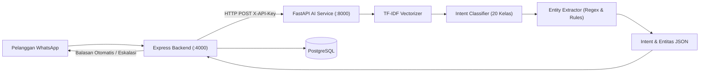
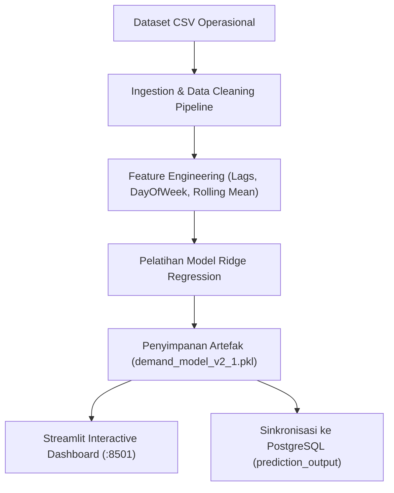

# 11 — Dokumentasi AI & Data Science

Dokumen ini mendokumentasikan arsitektur, metodologi, model klasifikasi teks, pipeline peramalan permintaan, dan antarmuka analitik pada modul **Kecerdasan Buatan (AI)** dan **Sains Data (Data Science)** sistem **NARA AC — CV. Nara Teknindotama** (Kode Proyek: **A26-CS054**).

---

## 1. Arsitektur Layanan AI (Natural Language Processing)

Modul AI NARA AC bertindak sebagai asisten virtual cerdas yang terhubung dengan gateway perpesanan WhatsApp untuk melayani pelanggan selama 24 jam sehari.

- **Teknologi Runtime:** Python 3.9+ dengan framework **FastAPI** dan server ASGI **Uvicorn**
- **Port Layanan:** `8000` (`http://localhost:8000`)
- **Autentikasi Antar-Layanan:** Header `X-API-Key` yang divalidasi oleh middleware `verify_api_key`
- **Model Pembelajaran Mesin:** Ekstraksi fitur n-gram teks menggunakan `TfidfVectorizer` dipadukan dengan pengklasifikasi linier (`LinearSVC` / `LogisticRegression`), dengan fallback murni Python (`ml_compat.py`) jika library scikit-learn tidak terinstal.

---

## 2. Taksonomi Intent & Ekstraksi Entitas

Model NLP NARA AC dilatih untuk mengenali **20 kelas intensi (intents)** spesifik industri perawatan pendingin ruangan:

| Kategori Intent | Deskripsi Fungsional | Contoh Frasa Masukan Pelanggan |
|---|---|---|
| `greeting` | Salam pembuka, sapaan, dan sapaan islami | *"Halo selamat pagi", "Assalamualaikum min"* |
| `tanya_layanan` | Pertanyaan seputar jenis paket servis AC | *"Layanan apa saja yang ada di Nara AC?"* |
| `tanya_harga` | Pertanyaan seputar tarif dan estimasi biaya | *"Berapa biaya cuci AC 1 PK di daerah Sleman?"* |
| `booking_service` | Niat melakukan pemesanan jadwal servis | *"Mau pesan servis cuci AC untuk besok jam 10"* |
| `tanya_status` | Pengecekan progres pesanan atau teknisi | *"Cek status booking saya nomor INV/20261017/0001"* |
| `batalkan_booking` | Permintaan pembatalan pemesanan | *"Saya mau batalkan jadwal servis besok"* |
| `ubah_jadwal` | Permintaan penjadwalan ulang kunjungan | *"Bisa geser jam kunjungannya ke sore jam 3?"* |
| `keluhan_ac` | Pelaporan gejala teknis atau kerusakan AC | *"AC saya netes air dan hembusan anginnya bau"* |
| `tanya_garansi` | Pertanyaan masa garansi dan klaim servis | *"Apakah ada garansi cuci AC kalau masih bocor?"* |
| `feedback` | Testimoni, ulasan, atau apresiasi kerja | *"Teknisinya ramah dan kerjanya sangat bersih, terima kasih"* |
| `tanya_teknisi` | Konfirmasi identitas teknisi yang bertugas | *"Siapa nama teknisi yang mau datang ke rumah saya?"* |
| `tanya_area_layanan` | Pengecekan cakupan wilayah jangkauan | *"Apakah melayani area Bantul dan Kulon Progo?"* |
| `tanya_pembayaran` | Informasi nomor rekening transfer dan bukti | *"Pembayarannya transfer ke rekening bank apa ya?"* |
| `tanya_prosedur` | SOP tahapan pengerjaan dan waktu pengerjaan| *"Berapa lama estimasi pengerjaan cuci besar?"* |
| `konfirmasi` | Persetujuan atas tawaran jadwal atau biaya | *"Oke saya setuju jadwal tersebut"* |
| `penolakan` | Penolakan tawaran jadwal atau opsi layanan | *"Tidak jadi min, terima kasih"* |
| `human_handoff` | Permintaan berbicara langsung dengan manusia | *"Tolong hubungkan saya dengan admin manusia"* |
| `admin_query` | Perintah manajemen operasional dari staf | *"Tampilkan ringkasan order hari ini"* |
| `tech_query` | Permintaan data dari teknisi lapangan | *"Kirimkan detail alamat pelanggan order #105"* |
| `lainnya` | Pesan di luar cakupan operasional pendingin | *"Cuaca hari ini panas sekali ya"* |

### Aturan Ekstraksi Entitas Otomatis (`extract_entities`)
Sistem secara cerdas mengekstraksi parameter bisnis penting dari teks bebas:
- **Daya AC (PK):** Mendeteksi `0.5 PK`, `1/2 PK`, `1 PK`, `1.5 PK`, `2 PK`.
- **Tipe AC:** Mendeteksi `Split`, `Cassette`, `Standing`, `Inverter`.
- **Jumlah Unit:** Mendeteksi angka eksplisit (*"2 unit"*, *"tiga buah AC"*).
- **Format Tanggal & Waktu:** Mendeteksi hari (*"besok"*, *"lusa"*, *"Senin depan"*) dan jam kunjungan (*"jam 10 pagi"*, *"14:00"*).
- **Nomor Invoice / Kode Booking:** Regex format `INV/\d{8}/\d+` atau format kode acak.

---

## 3. Batasan Keamanan & Etika AI (*AI Safety Boundaries*)

Sesuai aturan bisnis ketat NARA AC, modul AI **DILARANG KERAS** mengambil keputusan berikut secara mandiri tanpa verifikasi sistem backend atau admin:
1. **Dilarang Menyatakan Booking Berhasil:** AI hanya boleh mengonfirmasi bahwa permintaan telah dicatat dan menunggu konfirmasi ketersediaan teknisi.
2. **Dilarang Memvalidasi Pembayaran:** AI tidak boleh menyatakan bukti transfer sah atau invoice telah lunas sebelum tercatat di basis data oleh admin/bank.
3. **Dilarang Memberikan Diskon Ilegal:** AI tidak memiliki wewenang menegosiasikan harga di luar katalog resmi.
4. **Wajib Eskalasi Manusia:** Jika skor kepercayaan (*confidence score*) di bawah `0.55` atau pelanggan mengekspresikan kemarahan/klaim garansi sengketa, AI wajib menyalakan flag `is_escalated_to_admin: true` dan meneruskan percakapan ke admin manusia.

---

## 4. Pipeline Sains Data (Data Science & Analytics)

Modul Data Science berfokus pada optimasi operasional, pemeliharaan prediktif, peramalan beban kerja teknisi, dan segmentasi pelanggan.

- **Framework Dashboard:** Streamlit 1.35+ (`data-science/dashboard.py`)
- **Port Dashboard:** `8501` (`http://localhost:8501`)
- **Pipeline Pelatihan:** `data-science/ingest_and_train.py`
- **Kumpulan Data Operasional (CSV):**
  1. `dataset_transaksi_servis_ac.csv` (1.400+ baris data transaksi servis historis).
  2. `dataset_timeseries_harian.csv` (Data deret waktu harian untuk peramalan permintaan).
  3. `dataset_pelanggan_rfm.csv` (Data perilaku transaksi pelanggan untuk analisis RFM).
  4. `dataset_proyek_b2b_resik.csv` (Data kontrak pemeliharaan gedung B2B).

---

## 5. Model Peramalan Permintaan Servis (*Demand Forecasting*)

- **Algoritma:** Ridge Regression dengan regularisasi L2 (`alpha=1.0`)
- **Variabel Masukan (Fitur):**
  - Rata-rata permintaan 7 hari sebelumnya (*Lag 7* dan *Lag 14*)
  - Hari dalam seminggu (*Day of Week* — mendeteksi lonjakan di akhir pekan)
  - Bulan dalam tahun (*Seasonality* — mendeteksi musim kemarau dan kenaikan suhu)
- **Cakupan Proyeksi:** Peramalan permintaan order servis harian untuk **14 hari ke depan**.
- **Metrik Evaluasi Model:**
  - *Mean Absolute Error* (MAE): `< 1.85 order/hari`
  - *Root Mean Squared Error* (RMSE): `< 2.40 order/hari`
- **Manfaat Bisnis:** Memberikan rekomendasi jumlah teknisi *on-duty* kepada admin dispatcher untuk menghindari kelebihan kapasitas (*burnout*) atau kekurangan teknisi di hari puncak pemesanan.

---

## 6. Fitur Dashboard Analitik Streamlit

Dashboard Streamlit (`data-science/dashboard.py`) terdiri dari 4 tab analitik utama:

1. **📈 Operasional Riil:**
   - Memantau total booking, pendapatan kumulatif, rasio penyelesaian servis (*completion rate*), dan grafik beban kerja per teknisi.
2. **🔮 AI Demand Forecasting:**
   - Grafik interaktif deret waktu yang membandingkan tren permintaan historis dengan proyeksi permintaan 14 hari ke depan lengkap dengan batas estimasi ketidakpastian.
3. **📦 Inventaris & Feedback:**
   - Analisis perputaran stok suku cadang gudang (freon R32, R410A, kapasitor 25uF/35uF), peringatan stok di bawah batas minimum (*safety stock*), dan sebaran ulasan kepuasan pelanggan (CSAT / NPS).
4. **🏢 Proyek B2B & RFM Pelanggan:**
   - Visualisasi matriks segmentasi pelanggan berdasarkan *Recency*, *Frequency*, dan *Monetary* (Segmen: *Champions*, *Loyal*, *At Risk*, *Lost*) serta pemantauan siklus pemeliharaan kontrak gedung B2B.
