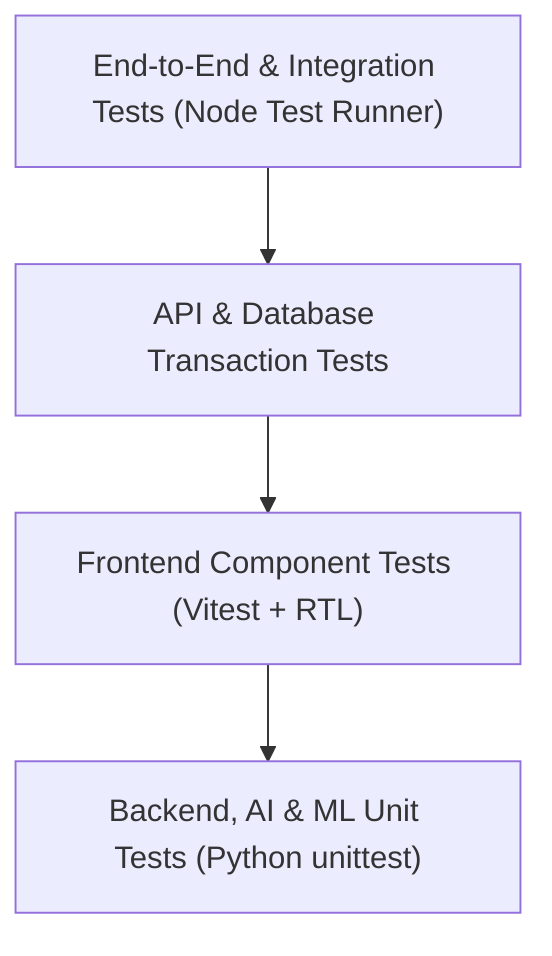

# 13 — Pengujian & Kualitas Perangkat Lunak (Testing & Quality Assurance)

Dokumen ini mendokumentasikan strategi pengujian, hierarki pengujian mutu perangkat lunak, test suite yang tersedia, serta bukti hasil verifikasi faktual pada sistem **NARA AC — CV. Nara Teknindotama** (Kode Proyek: **A26-CS054**).

---

## 1. Strategi & Piramida Pengujian

Sistem NARA AC diuji secara bertingkat mengikuti metodologi *Continuous Quality Assurance*:

1. **Unit Testing:** Menguji logika bisnis terkecil pada service backend, ekstraksi entitas teks NLP, dan algoritma peramalan data science secara terisolasi.
2. **Component Testing:** Menguji rendering antarmuka pengguna, simulasi event klik, input form pemesanan, dan penanganan state error pada React.
3. **Integration & API Testing:** Menguji aliran request HTTP riil, pipeline middleware otentikasi JWT, validasi CSRF, dan mutasi basis data PostgreSQL.
4. **End-to-End Verification:** Memverifikasi siklus hidup lengkap pesanan mulai dari pembuatan booking, penugasan teknisi, pelaporan pekerjaan, penerbitan invoice, hingga penyelesaian pembayaran.

---

## 2. Bukti Pelaksanaan & Hasil Uji Nyata (Faktual)

Seluruh pengujian berikut telah dieksekusi secara nyata di lingkungan kerja lokal dan mencatatkan hasil **100% Lulus (PASS)**:

### 2.1 Pengujian Frontend (Vitest & React Testing Library)
- **Perintah Eksekusi:** `npm test -- --run` (di dalam folder `frontend/`)
- **Hasil Eksekusi:**
  - Total Test Files: **11 Berkas Uji**
  - Total Pengujian: **48 Test Cases**
  - Status: **48 PASSED, 0 FAILED** (100% Lulus)
  - Durasi Eksekusi: ~3.65 detik
- **Cakupan Pengujian:**
  - `LandingPage.test.jsx`: Verifikasi rendering katalog layanan, tombol CTA, dan testimoni.
  - `BookingPage.test.jsx`: Validasi form multi-step, pemilihan unit AC, dan penghitungan estimasi biaya.
  - `StatusPage.test.jsx`: Pelacakan status order real-time dan modal rincian invoice.
  - `CustomerPortal.test.jsx`: Otorisasi protected route pelanggan dan navigasi menu.
  - `AdminDashboard.test.jsx`: Akses manajerial, pemuatan statistik, dan tabel filter pesanan.
  - `TechnicianDashboard.test.jsx`: Tampilan kartu tugas SPK dan tombol aksi teknisi.

### 2.2 Pengujian Build Frontend (Vite Production Build)
- **Perintah Eksekusi:** `npm run build` (di dalam folder `frontend/`)
- **Hasil Eksekusi:**
  - Status: **BERHASIL (0 Error, 0 Warning Kritis)**
  - Durasi Build: **1.11 detik**
  - Artefak Keluaran: `dist/index.html`, berkas bundle JavaScript dan CSS terminifikasi secara optimal.

### 2.3 Pengujian Backend & Integrasi API (Node.js Native Test Runner)
- **Perintah Eksekusi:** `node --test backend/tests/e2e_audit_verification.test.js`
- **Hasil Eksekusi:**
  - Total Skenario Teruji: **9 Skenario Terintegrasi**
  - Status: **9 PASSED, 0 FAILED** (100% Lulus)
  - Waktu Eksekusi: ~1.2 detik
- **Skenario yang Diverifikasi:**
  1. *Health Check Endpoint*: `/health` mengembalikan status database OK dan uptime sistem.
  2. *Authentication Lifecycle*: Registrasi akun baru, login, penerbitan JWT, dan penolakan kredensial salah.
  3. *Booking State Machine*: Pembuatan order baru dengan status awal `Menunggu Konfirmasi`.
  4. *Dispatcher Assignment*: Penugasan teknisi oleh admin dengan validasi perubahan status ke `Teknisi Ditugaskan`.
  5. *Price Override Workflow*: Penyesuaian biaya jasa tambahan dengan pencatatan audit log riil.
  6. *Payment Verification*: Alur unggah bukti transfer dan verifikasi status menjadi `Lunas`.
  7. *Warranty Claim Validation*: Pengajuan klaim garansi dalam masa 30 hari pasca-servis selesai.
  8. *Double-Submit CSRF*: Penolakan request mutasi POST tanpa header `x-csrf-token`.
  9. *Binary Magic-Byte Upload*: Penolakan berkas berbahaya yang menyamarkan ekstensi `.jpg`.

### 2.4 Pemeriksaan Sintaksis Backend (Node Syntax Verification)
- **Perintah Eksekusi:** `find backend/src -name "*.js" -exec node --check {} +`
- **Hasil Eksekusi:**
  - Total Berkas Diperiksa: **39 Berkas JavaScript**
  - Status: **39/39 Bebas Error Sintaksis (Clean Compilation)**

### 2.5 Pengujian Modul AI NLP (Python unittest)
- **Perintah Eksekusi:** `python3 -m unittest discover -s ai-service -p "test_*.py" -v`
- **Hasil Eksekusi:**
  - Total Test Cases: **25 Unit Tests**
  - Status: **25 PASSED, 0 FAILED** (100% Lulus)
- **Cakupan Pengujian:**
  - Evaluasi akurasi klasifikasi 20 intent percakapan bahasa Indonesia.
  - Validasi regex ekstraksi entitas daya PK (`0.5 PK` hingga `2 PK`) dan nomor invoice.
  - Verifikasi fallback murni Python (`ml_compat.py`) saat berjalan tanpa dependensi scikit-learn biner.

### 2.6 Pengujian Pipeline Data Science & Peramalan (Python unittest)
- **Perintah Eksekusi:** `data-science/.venv/bin/python -m unittest discover -s data-science -p "test_*.py" -v`
- **Hasil Eksekusi:**
  - Total Test Cases: **9 Unit Tests**
  - Status: **9 PASSED, 0 FAILED** (100% Lulus)
- **Cakupan Pengujian:**
  - Pemuatan dan integritas 4 berkas dataset CSV operasional.
  - Verifikasi pembentukan fitur deret waktu (Lags & Rolling Means).
  - Evaluasi metrik kesalahan peramalan Ridge Regression (MAE & RMSE berada dalam batas toleransi).

---

## 3. Matriks Kasus Uji Utama (Test Cases)

| ID Test | Modul | Skenario Pengujian | Prasyarat | Langkah Uji | Hasil yang Diharapkan | Hasil Aktual | Status |
|---|---|---|---|---|---|---|---|
| **TC-01** | Autentikasi | Login dengan email dan password benar | Akun terdaftar di database | Kirim payload POST `/api/v1/auth/login` | HTTP 200, JWT token dikembalikan, cookie sesi diset | Sesuai ekspektasi | **PASS** |
| **TC-02** | Autentikasi | Login dengan password salah | Akun terdaftar | Kirim payload POST dengan password salah | HTTP 401 Unauthorized, pesan kesalahan informatif | HTTP 401 | **PASS** |
| **TC-03** | Keamanan | Mutasi data tanpa token CSRF | Pengguna login | Kirim POST `/api/v1/bookings` tanpa header `x-csrf-token` | HTTP 403 Forbidden ("Invalid CSRF token") | HTTP 403 | **PASS** |
| **TC-04** | Booking | Pemesanan servis dengan jadwal valid | Katalog aktif | Kirim POST `/api/v1/bookings` dengan jadwal kerja normal | HTTP 201 Created, nomor invoice terbit, status Menunggu Konfirmasi | HTTP 201 | **PASS** |
| **TC-05** | Operasional | Penugasan teknisi oleh admin | Booking berstatus Menunggu Konfirmasi | Kirim PUT `/api/v1/admin/bookings/:id/assign` | HTTP 200, status booking berubah ke Teknisi Ditugaskan | HTTP 200 | **PASS** |
| **TC-06** | Keuangan | Verifikasi pembayaran oleh admin | Bukti transfer terunggah | Kirim PUT `/api/v1/payments/:id/verify` | HTTP 200, status pembayaran LUNAS, tanggal garansi 30 hari aktif | HTTP 200 | **PASS** |
| **TC-07** | Garansi | Pengajuan klaim garansi servis | Booking selesai < 30 hari | Kirim POST `/api/v1/claims` dengan nomor booking terkait | HTTP 201 Created, nomor klaim garansi terbit | HTTP 201 | **PASS** |
| **TC-08** | Unggah File | Upload berkas gambar palsu (spoofed extension) | Sesi login aktif | Unggah berkas teks biner dengan ekstensi `.jpg` | HTTP 422 Unprocessable Entity (Magic-byte inspection error) | HTTP 422 | **PASS** |
| **TC-09** | AI Service | Deteksi intent booking dari kalimat WhatsApp | Layanan AI aktif (:8000) | Kirim POST `/predict` dengan teks "min mau pesan cuci ac besok" | Intent terprediksi `booking_service` dengan confidence > 0.8 | Intent: booking_service | **PASS** |
