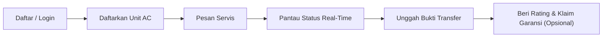

# 15 — Panduan Pengguna Berdasarkan Peran (User Manual)

Dokumen ini mendokumentasikan petunjuk operasional langkah demi langkah bagi setiap peran pengguna pada aplikasi **NARA AC — CV. Nara Teknindotama** (Kode Proyek: **A26-CS054**).

---

## 1. Panduan Pengguna: Pelanggan (Customer)

Portal Pelanggan dirancang intuitif, responsif terhadap perangkat ponsel, dan dapat diakses melalui tautan utama [`http://localhost:5173`](http://localhost:5173) atau domain resmi perusahaan.

### 1.1 Pendaftaran Akun & Masuk Aplikasi
1. Buka peramban dan navigasikan ke menu **Daftar** (`/register`) atau **Masuk** (`/login`).
2. Masukkan nama lengkap, alamat email aktif, nomor WhatsApp aktif, dan buat kata sandi yang aman.
3. Alternatif lain, pilih opsi **Masuk dengan WhatsApp OTP** untuk menerima 6-digit kode verifikasi instan tanpa perlu mengingat kata sandi.

### 1.2 Mengelola Data Unit AC (`/customer/units`)
1. Masuk ke **Portal Pelanggan** dan pilih menu **Unit AC Saya**.
2. Klik tombol **+ Tambah Unit AC**.
3. Isi informasi perangkat:
   - **Merek & Seri:** Contoh: Daikin Inverter FTKQ25.
   - **Daya Pendingin (PK):** Pilih `0.5 PK`, `1 PK`, `1.5 PK`, atau `2 PK`.
   - **Tipe AC:** `Split Wall`, `Cassette`, atau `Standing Floor`.
   - **Lokasi Ruangan:** Contoh: "Kamar Tidur Utama", "Ruang Tamu", atau "Lantai 2".
4. Klik **Simpan Unit**. Data unit ini dapat langsung dipilih pada formulir pemesanan berikutnya tanpa perlu mengetik ulang spesifikasi.

### 1.3 Melakukan Pemesanan Servis (`/booking`)
1. Klik tombol **Pesan Sekarang** pada bilah navigasi atas.
2. **Langkah 1 (Pilih Layanan):** Pilih paket yang diinginkan (misal: Cuci AC Split, Tambah Freon R32, atau Perbaikan Kebocoran).
3. **Langkah 2 (Pilih Unit):** Centang unit AC yang telah didaftarkan sebelumnya atau masukkan jumlah unit secara manual.
4. **Langkah 3 (Jadwal & Waktu):** Pilih tanggal kunjungan yang diinginkan dan pilih slot jam kunjungan yang tersedia (Slot: Pagi `08:00 - 12:00` atau Siang `13:00 - 17:00`).
5. **Langkah 4 (Alamat & Keluhan):** Konfirmasi alamat domisili dan tuliskan catatan gejala kerusakan (misal: "AC kurang dingin dan keluar tetesan air di indoor").
6. Klik **Konfirmasi Booking**. Sistem akan menerbitkan **Nomor Invoice** resmi (contoh: `INV/20261025/0014`) dan menampilkan ringkasan biaya.

### 1.4 Melacak Status Pesanan & Pembayaran (`/status/:kode`)
1. Buka halaman pelacakan menggunakan tautan yang dikirimkan via WhatsApp atau melalui menu **Riwayat Booking**.
2. Periksa status tahapan:
   - *Menunggu Konfirmasi*: Admin sedang memeriksa ketersediaan teknisi.
   - *Teknisi Ditugaskan*: Teknisi telah dialokasikan (nama dan nomor telepon teknisi ditampilkan).
   - *Dalam Perjalanan*: Teknisi sedang menuju alamat Anda.
   - *Sedang Dikerjakan*: Pekerjaan servis sedang berlangsung.
   - *Menunggu Pembayaran*: Pekerjaan selesai, rincian biaya final telah diterbitkan.
3. Pilih metode pembayaran **Transfer Bank** (BCA / Mandiri resmi CV. Nara Teknindotama).
4. Klik tombol **Unggah Bukti Transfer**, pilih foto struk ATM atau tangkapan layar m-Banking, lalu klik **Kirim Bukti Pembayaran**.
5. Setelah diverifikasi oleh admin, status berubah menjadi **LUNAS** dan kartu garansi aktif otomatis selama 30 hari.

### 1.5 Memberikan Ulasan & Mengajukan Klaim Garansi
- **Ulasan (`/feedback/:kode`):** Berikan rating 1 sampai 5 bintang serta komentar testimoni untuk membantu kami meningkatkan kualitas layanan teknisi.
- **Klaim Garansi:** Jika dalam kurun waktu 30 hari AC mengalami kendala yang sama, buka menu detail pesanan dan klik tombol **Ajukan Klaim Garansi**. Tuliskan keluhan dan lampirkan foto kendala. Tim admin akan menghubungi untuk kunjungan ulang tanpa biaya servis tambahan (*Zero-Cost Warranty Visit*).

---

## 2. Panduan Pengguna: Teknisi Lapangan (Technician)

Portal Teknisi dirancang khusus dengan tombol-tombol berukuran besar yang ramah sentuhan (*touch-friendly*) untuk kenyamanan penggunaan langsung di lapangan.

### 2.1 Masuk ke Portal Teknisi (`/staff/login`)
1. Buka peramban di ponsel pintar dan akses halaman `/staff/login`.
2. Masukkan email dinas teknisi dan kata sandi yang telah didaftarkan oleh admin.
3. Sistem secara otomatis mengarahkan ke dashboard utama teknisi (`/technician/dashboard`).

### 2.2 Melihat Daftar Tugas & Surat Perintah Kerja (SPK)
1. Dashboard menampilkan kartu-kartu pekerjaan aktif yang diurutkan berdasarkan jam kunjungan hari ini.
2. Setiap kartu tugas memuat:
   - Nomor SPK dan Jam Kunjungan.
   - Nama dan Nomor Telepon Pelanggan (terdapat tombol langsung *Hubungi WhatsApp*).
   - Alamat Lengkap Pelanggan (terdapat tombol *Buka Google Maps*).
   - Spesifikasi Unit AC dan Catatan Keluhan Awal.

### 2.3 Memperbarui Progres Kerja di Lokasi
1. Saat hendak berangkat menuju lokasi pelanggan, klik tombol **Mulai Perjalanan**. Status sistem akan berubah menjadi `Dalam Perjalanan` dan pelanggan menerima notifikasi.
2. Saat tiba di gerbang/rumah pelanggan, klik tombol **Tiba di Lokasi**.
3. Saat mulai melakukan pembongkaran casing AC, klik tombol **Mulai Pengerjaan**.

### 2.4 Mengisi Checklist SOP & Dokumentasi Foto (`/technician/jobs/:id`)
1. **Foto Sebelum Servis (*Before*):** Sebelum dicuci/diperbaiki, ambil foto kondisi filter kotor, sirip evaporator berlendir, atau tekanan refrigeran pada manifold gauge. Unggah foto pada bagian *Dokumentasi Sebelum Servis*.
2. **Daftar Periksa (*Checklist SOP*):** Centang seluruh tahapan keselamatan:
   - [x] Pemutusan aliran listrik utama (MCB/Steker).
   - [x] Pemasangan plastik pelindung cuci AC (*drain jacket*).
   - [x] Pemeriksaan suhu hembusan awal.
   - [x] Pembersihan filter udara dan casing indoor.
   - [x] Pembersihan sirip evaporator indoor.
   - [x] Pembersihan baling-baling fan blower.
   - [x] Pembersihan sirip kondensor outdoor.
   - [x] Pemeriksaan kelancaran pipa pembuangan air (*drain hose*).
   - [x] Pengukuran tekanan freon akhir (PSI) dan arus listrik (Ampere).
3. **Pencatatan Suku Cadang:** Jika terdapat penggantian kapasitor atau penambahan freon, pilih suku cadang dari daftar gudang dan masukkan jumlah unit yang digunakan.
4. **Foto Sesudah Servis (*After*):** Ambil foto evaporator yang telah bersih berkilau dan unit yang telah terpasang rapi kembali.
5. **Tanda Tangan Digital:** Serahkan ponsel ke pelanggan untuk membubuhkan tanda tangan digital pada layar sentuh sebagai bukti penerimaan hasil servis.
6. Klik tombol **Selesaikan Pekerjaan & Terbitkan BAP**.

---

## 3. Panduan Pengguna: Administrator (Admin)

Portal Administrator merupakan pusat kendali manajerial menyeluruh yang diakses melalui desktop atau tablet pada rute `/admin`.

### 3.1 Dashboard & Pemantauan Operasional (`/admin`)
- Memantau metrik performa secara *real-time*:
  - Total Booking Hari Ini & Antrean Menunggu Konfirmasi.
  - Jumlah Teknisi yang Sedang Bertugas vs Teknisi Siaga.
  - Omzet Pendapatan Mingguan/Bulanan.
  - Indeks Kepuasan Pelanggan (CSAT Rata-Rata Bintang).

### 3.2 Alokasi & Penugasan Teknisi (Dispatcher) (`/admin/bookings`)
1. Buka menu **Daftar Booking**.
2. Klik pesanan yang berstatus `Menunggu Konfirmasi`.
3. Pada panel *Penugasan Teknisi*, pilih nama teknisi yang memiliki status *Tersedia* dan berada di zona wilayah terdekat.
4. Klik **Tugaskan Teknisi**. Surat Perintah Kerja (SPK) akan terbit otomatis dan notifikasi jadwal dikirimkan ke ponsel teknisi.

### 3.3 Penyesuaian Biaya Tambahan (*Price Override*)
1. Jika teknisi melaporkan temuan kebocoran pipa atau kapasitor mati saat di lapangan, admin dapat membuka menu detail booking terkait.
2. Klik tombol **Sesuaikan Biaya (Override Price)**.
3. Masukkan item biaya tambahan dan alasan teknis secara transparan.
4. Total tagihan pada invoice akan diperbarui secara otomatis dan tercatat dalam `booking_audit`.

### 3.4 Verifikasi Pembayaran & Penerbitan Kwitansi (`/admin/invoices`)
1. Buka menu **Manajemen Faktur & Pembayaran**.
2. Filter pesanan dengan status `Menunggu Verifikasi`.
3. Klik untuk melihat foto bukti transfer bank yang diunggah oleh pelanggan.
4. Bandingkan nominal bukti transfer dengan mutasi rekening koran bank.
5. Jika dana telah masuk, klik tombol **Verifikasi Pembayaran (Tandai Lunas)**.
6. Status transaksi berubah menjadi `Lunas`, masa garansi 30 hari aktif, dan kwitansi resmi dikirimkan via WhatsApp.

### 3.5 Pengelolaan Klaim Garansi (`/admin/claims`)
1. Buka menu **Klaim Garansi**.
2. Periksa nomor booking awal, deskripsi kendala, dan foto bukti yang dikirimkan pelanggan.
3. Jika klaim masih dalam kurun waktu 30 hari pasca-servis, klik **Setujui Klaim & Jadwalkan Kunjungan Ulang**.
4. Tugaskan teknisi penanggung jawab (diprioritaskan teknisi yang sama untuk konsistensi evaluasi).
