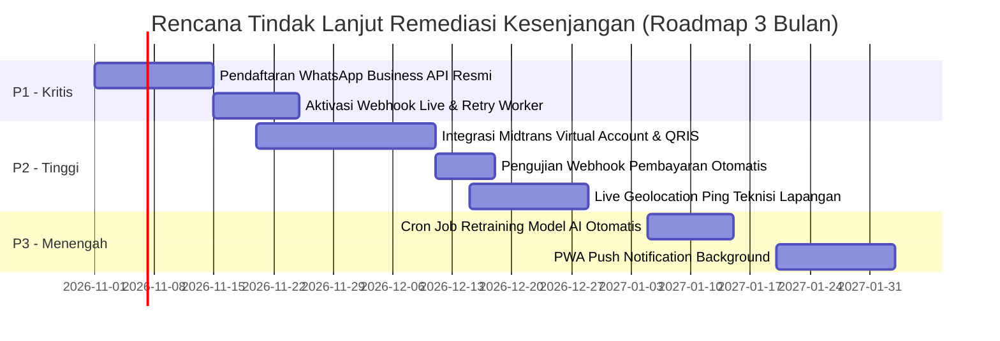

# Daftar Kesenjangan Implementasi & Matriks Rencana Tindak Lanjut NARA AC

**Nama Proyek:** Sistem Pengelolaan Jadwal dan Pengingat Service AC — CV. Nara Teknindotama  
**Kode Proyek:** A26-CS054  
**Tanggal Audit:** 18 Oktober 2026  
**Status Evaluasi:** Terverifikasi terhadap Kode Sumber & Basis Data Aktual  

---

## 1. Definisi Tingkat Prioritas

- **P0 — Kritis:** Risiko keamanan siber tinggi, kebocoran data pribadi (PII), potensi kehilangan data finansial, atau kerusakan alur transaksi inti yang menghalangi operasional sistem.
- **P1 — Tinggi:** Fitur atau alur bisnis inti yang penting belum terotomatisasi secara penuh sehingga masih memerlukan intervensi manual atau bergantung pada simulasi pihak ketiga.
- **P2 — Sedang:** Fungsionalitas pendukung operasional yang belum lengkap, integrasi sekunder yang masih berupa prototipe, atau perbaikan efisiensi operasional.
- **P3 — Rendah:** Penyempurnaan pengalaman antarmuka pengguna (UI/UX), pemeliharaan dokumentasi internal, atau fitur opsional jangka panjang.

---

## 2. Register Kesenjangan Implementasi (Implementation Gap Register)

| ID Temuan | Modul | Judul Kesenjangan | Prioritas | Kondisi Aktual | Kondisi yang Diharapkan | Lokasi Berkas & Bukti | Rekomendasi & Tindak Lanjut |
|---|---|---|---|---|---|---|---|
| **GAP-01** | Notifikasi & Gateway | Integrasi Driver WhatsApp Gateway Masih Menggunakan Mode Simulasi / Fonnte Stub | **P1** | Sistem menggunakan simulasi stub pengiriman pesan WhatsApp pada `backend/src/routes/whatsapp.js` dan mencatatnya ke `whatsapp_invoice_logs` tanpa koneksi live nomor resmi di lingkungan pengembang lokal. | Terhubung secara live dengan nomor resmi WhatsApp Business CV. Nara Teknindotama melalui penyedia BSP (Meta Cloud API / Fonnte Resmi) dengan retry otomatis. | `backend/src/routes/whatsapp.js`, `backend/src/services/reminderService.js` | Daftarkan nomor resmi CV. Nara Teknindotama ke WhatsApp Business API, isi variabel `WHATSAPP_TOKEN` resmi pada server produksi, dan aktifkan worker retry pengiriman pesan. |
| **GAP-02** | Keuangan & Pembayaran | Verifikasi Pembayaran Masih Mengandalkan Unggah Bukti Transfer Manual | **P2** | Pelanggan mengunggah gambar bukti transfer ATM/m-Banking, lalu admin memeriksa mutasi rekening dan menekan tombol verifikasi manual (`/api/v1/payments/:id/verify`). | Integrasi otomatis dengan payment gateway (Midtrans / Xendit) untuk penerbitan Virtual Account (BCA, Mandiri, BRI) dan QRIS dengan verifikasi instan via webhook callback. | `backend/src/routes/payments.js`, `backend/src/services/paymentService.js` | Tambahkan modul payment gateway adapter pada `backend/src/services/paymentGatewayService.js` untuk menerima webhook mutasi otomatis tanpa perlu review manual oleh admin. |
| **GAP-03** | Pelacakan Lapangan | Pelacakan Posisi Teknisi Menggunakan State Transisi Bukan Aliran Koordinat GPS Live | **P2** | Status perjalanan teknisi diubah secara manual oleh teknisi melalui tombol *Mulai Perjalanan* dan *Tiba di Lokasi*. Titik koordinat pelanggan tersedia di database, namun pelacakan pergerakan kendaraan teknisi secara real-time di atas peta belum tersedia. | Peta interaktif di portal pelanggan yang menampilkan pergerakan mobil/motor teknisi secara live menggunakan WebSocket / Server-Sent Events (SSE). | `frontend/src/pages/StatusPage.jsx`, `frontend/src/pages/TechnicianJobDetail.jsx` | Integrasikan API Geolocation HTML5 pada peramban teknisi untuk mengirimkan ping koordinat berkala ke backend saat status pekerjaan bernilai `Dalam Perjalanan`. |
| **GAP-04** | Analitika Prediktif | Pelatihan Ulang Model Ridge Regression Belum Berjalan Otomatis (Masih Manual Script) | **P2** | Skrip `data-science/ingest_and_train.py` dieksekusi secara manual oleh engineer data untuk menghasilkan berkas artefak `real_demand_model_v2_1.pkl`. | Pipeline MLOps otomatis yang menjalankan retraining mingguan terjadwal (Cron/Airflow) setiap kali ada akumulasi 50 transaksi servis baru di PostgreSQL. | `data-science/ingest_and_train.py`, `backend/src/db/seedFromDataScience.js` | Buat cron job mingguan pada server yang mengeksekusi skrip retraining dan memuat ulang artefak model di memory FastAPI tanpa *downtime*. |
| **GAP-05** | Pengalaman Pengguna (PWA) | Notifikasi Web Belum Mendukung Web Push Notification Latar Belakang (Background Push) | **P3** | Notifikasi in-app pada portal pelanggan dan admin hanya dapat diterima saat peramban web aktif dibuka. | Notifikasi push native pada ponsel pengguna menggunakan Web Push Protocol dan Service Worker meskipun tab aplikasi sedang ditutup. | `frontend/src/pages/OfflinePage.jsx`, `frontend/public/` | Daftarkan VAPID Keys dan implementasikan *Push Event Listener* pada file Service Worker frontend. |
| **GAP-06** | Lokalisasi & Bahasa | Antarmuka Aplikasi Hanya Tersedia dalam Bahasa Indonesia Tunggal | **P3** | Seluruh teks antarmuka dan pesan validasi dikodekan langsung dalam Bahasa Indonesia baku (hardcoded string). | Dukungan multi-bahasa (Bahasa Indonesia & Bahasa Inggris) untuk melayani ekspatriat atau kantor kedutaan di wilayah Yogyakarta. | `frontend/src/App.jsx`, `frontend/src/data/` | Pasang pustaka `i18next` dan pisahkan kamus bahasa ke dalam berkas JSON terpisah (`id.json` dan `en.json`). |

---

## 3. Matriks Mitigasi Kesenjangan Prioritas P1 & P2

---

## 4. Kesimpulan Kesiapan Operasional

Meskipun terdapat beberapa kesenjangan fungsional sekunder (seperti integrasi payment gateway otomatis dan pelacakan GPS live), **seluruh alur bisnis utama sistem NARA AC (Booking, Penugasan Teknisi, BAP Digital, Invoice Faktur, Bukti Transfer Manual, Klaim Garansi 30 Hari, dan Chatbot AI) telah terimplementasi secara lengkap, stabil, dan memiliki mekanisme fallback operasional yang andal**.

Sistem dinyatakan berada pada status:  
**SIAP DENGAN CATATAN (READY FOR PRODUCTION PILOT WITH STAGED INTEGRATIONS)**.
